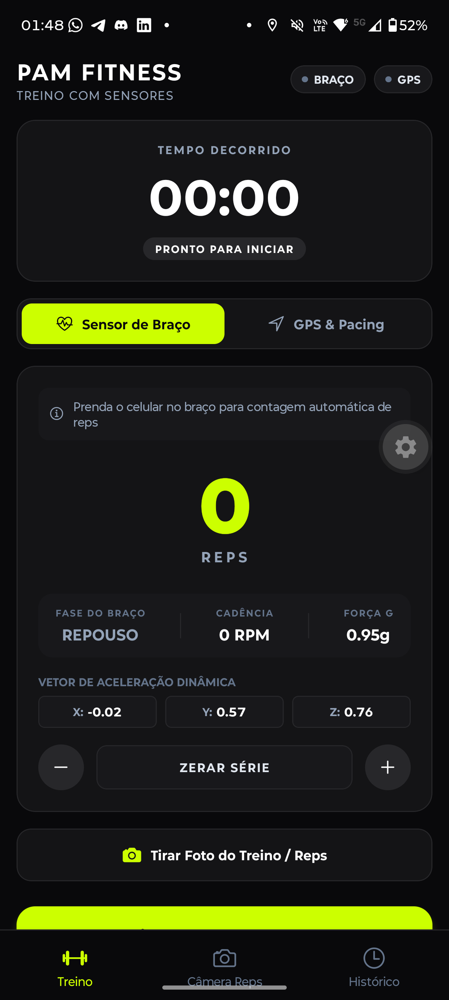
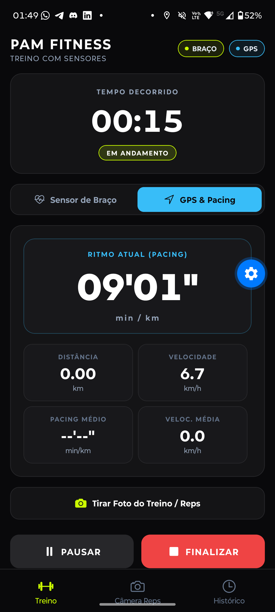
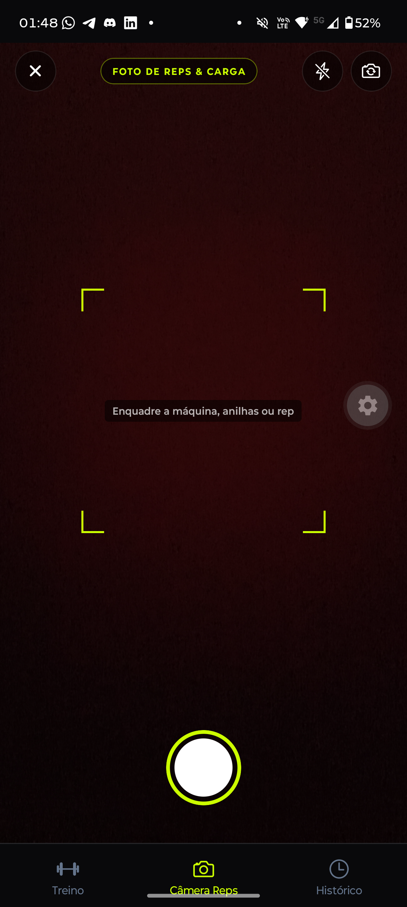
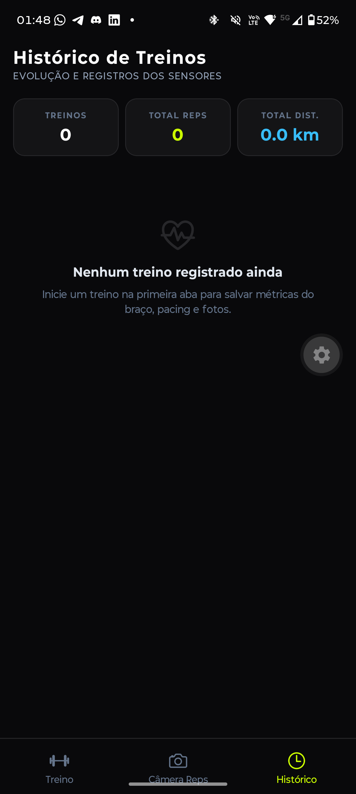

# 🏋️‍♂️ PAM Fitness — Treino com Sensores de Hardware

<p align="center">
  
  
  
  
  
</p>

---

## 📱 Visão Geral do Projeto

O **PAM Fitness** é um aplicativo mobile desenvolvido para a disciplina de **Programação de Aplicativos Mobile (PAM)** da **FATEC**. O objetivo central é transformar o smartphone do usuário em um dispositivo vestível esportivo autossuficiente ao ser fixado no braço através de uma braçadeira elástica, dispensando o uso de relógios inteligentes (*smartwatches*) adicionais.

O aplicativo integra simultaneamente **três sensores nativos de hardware**:
1. **Sensor de Movimento (Acelerômetro MEMS):** monitora a aceleração tridimensional para detecção biomecânica automática de repetições e cálculo de cadência (RPM).
2. **Sensor de Localização (GPS / GNSS):** triangula coordenadas com alta resolução para computar distância percorrida, velocidade instantânea e ritmo de *pacing* esportivo (`MM'SS" /km`).
3. **Sensor Óptico (Câmera Nativa):** registra fotos de aparelhos, pesos e anilhas durante a série, permitindo auditoria visual com anotações textuais.
4. **Persistência Local Offline-First:** armazena todas as sessões e fotos no próprio smartphone via `@react-native-async-storage/async-storage`.

---

## 📸 Demonstração Visual da Aplicação Real

Abaixo estão as capturas de tela reais do aplicativo em execução no dispositivo físico:

<table>
  <thead>
    <tr align="center">
      <th width="25%">1. Sensor de Braço (Reps)</th>
      <th width="25%">2. GPS & Telemetria de Pacing</th>
      <th width="25%">3. Câmera de Séries & Cargas</th>
      <th width="25%">4. Histórico Consolidado</th>
    </tr>
  </thead>
  <tbody>
    <tr valign="top">
      <td>
        
        <br><br>
        <strong>⚡ Modo Sensor de Braço:</strong>
        <ul>
          <li>Cronômetro atômico esportivo</li>
          <li>Contagem automática de <strong>Reps</strong></li>
          <li>Fase muscular: <em>Repouso</em>, <em>Subindo</em>, <em>Descendo</em></li>
          <li>Cadência em tempo real (<strong>RPM</strong>)</li>
          <li>Força G instantânea e vetores X, Y, Z</li>
          <li>Ajustes manuais rápidos (+1, -1)</li>
        </ul>
      </td>
      <td>
        
        <br><br>
        <strong>🌐 Modo GPS & Pacing:</strong>
        <ul>
          <li>Indicadores de sinal de satélite</li>
          <li>Ritmo esportivo de <strong>Pacing</strong> (<code>09'01" /km</code>)</li>
          <li>Distância acumulada via Haversine</li>
          <li>Velocidade instantânea e média (km/h)</li>
          <li>Filtro contra saltos anômalos de sinal</li>
          <li>Controles de pausa e finalização</li>
        </ul>
      </td>
      <td>
        
        <br><br>
        <strong>📷 Auditoria por Câmera:</strong>
        <ul>
          <li>Componente moderno <code>CameraView</code></li>
          <li>Retículas de enquadramento esportivo</li>
          <li>Controle de lanterna LED contínua (<em>Torch</em>)</li>
          <li>Alternância entre câmera frontal e traseira</li>
          <li>Pré-visualização imediata com anotação da série</li>
        </ul>
      </td>
      <td>
        
        <br><br>
        <strong>📊 Histórico Offline:</strong>
        <ul>
          <li>Totais agregados (treinos, reps, km)</li>
          <li>Lista decrescente de sessões passadas</li>
          <li>Carregamento automático com <code>useFocusEffect</code></li>
          <li>Auditoria visual de fotos capturadas</li>
          <li>Exclusão individual ou limpeza geral</li>
        </ul>
      </td>
    </tr>
  </tbody>
</table>

---

## ⚙️ Engenharia e Funcionamento dos Sensores

### 1. Acelerômetro Tridimensional & Máquina de Estados (FSM)
- **Magnitude Euclidiana Invariante:** Como a inclinação do celular no braço varia de acordo com o atleta, o app calcula a magnitude escalar tridimensional:
  $$\text{Magnitude} = \sqrt{x^2 + y^2 + z^2}$$
- **Máquina de Estados Finita (FSM):**
  - **Repouso:** Magnitude oscila em torno da gravidade estática terrestre ($\approx 1.0g$).
  - **Fase Concêntrica (Subida):** Aceleração muscular eleva a magnitude para $\ge 1.25g$ (muda para `esperando_vale`).
  - **Fase Excêntrica (Descida):** Desaceleração reduz a magnitude para $\le 0.85g$.
  - **Filtro de Debounce Temporal de 700ms:** Descarta tremores musculares involuntários, clônus de fadiga e impactos de anilhas. Movimentos em menos de 0,7 segundos são rejeitados.
- **Cadência em Tempo Real (RPM):**
  $$\text{RPM} = (\text{repetições nos últimos 30 segundos}) \times 2$$

### 2. Sensor de GPS & Ritmo de Pacing
- **Fórmula de Haversine:** Calcula a distância esférica entre coordenadas consecutivas $(\text{lat}_1, \text{lon}_1)$ e $(\text{lat}_2, \text{lon}_2)$ considerando o raio da Terra de 6.371 km.
- **Filtro de Descarte de Ruído:** Saltos de deslocamento superiores a 50 metros em 1 segundo (equivalente a $180\text{ km/h}$) são descartados como anomalia de sinal refletido.
- **Pacing Esportivo (Minutos por Quilômetro):**
  $$\text{Pacing} = \frac{1000}{v\text{ (m/s)}} \implies \text{Formatado em } \text{MM'SS" /km}$$
  Velocidades abaixo de $0.5\text{ m/s}$ exibem repouso (`--'--"`).

### 3. Câmera Nativa (`CameraView`)
- Utiliza a API contemporânea do Expo SDK 57 com hook reativo `useCameraPermissions()`.
- Captura fotos otimizadas (`quality: 0.85`), permitindo vincular anotações de carga e auditá-las no modal de tela cheia do histórico.

---

## 🌳 Estrutura de Pastas e Módulos

```text
App PAM/
├── docs/                                # Documentação técnica consolidada
│   ├── PAM_Fitness_Documentacao_Completa.pdf  # Manual técnico completo em PDF (15 páginas)
│   ├── build_documentation_pdf.py       # Script gerador automatizado da documentação
│   ├── README.md                        # Documentação da arquitetura e escopo
│   ├── SENSORES.md                      # Engenharia física dos 3 sensores
│   ├── FUNCOES_REACT.md                 # Catálogo detalhado de Hooks React e Expo
│   └── GUIA_DE_CHAMADAS.md              # Catálogo de assinaturas e fluxo de execução
├── prints/                              # Capturas de tela reais do aplicativo em execução
│   ├── 01_treino_sensor_braco.png       # Tela de treino ativo com sensor de braço
│   ├── 02_treino_gps_pacing.png         # Tela de treino ativo com telemetria GPS
│   ├── 03_camera_auditoria_reps.png     # Visor da câmera de séries
│   └── 04_historico_sessoes.png         # Painel de histórico e estatísticas offline
├── src/
│   ├── app/                             # Rotas e telas nativas do Expo Router
│   │   ├── _layout.tsx                  # Navegador em abas nativas inferiores
│   │   ├── index.tsx                    # Tela principal: treino ativo, acelerômetro e GPS
│   │   ├── camera.tsx                   # Tela da câmera: captura de foto e notas
│   │   └── historico.tsx                # Tela de histórico: métricas e fotos salvas
│   ├── constants/
│   │   └── theme.ts                     # Tokens de design (Dark Mode Atlântico)
│   ├── hooks/                           # Custom Hooks de hardware e controle
│   │   ├── useWorkoutTimer.ts           # Cronômetro esportivo atômico com start/pause/resume
│   │   ├── useArmMotionTracker.ts       # Acelerômetro, magnitude 3D, FSM e cadência RPM
│   │   └── useLocationTracker.ts        # GPS de alta resolução, Haversine e ritmo de pacing
│   ├── services/                        # Lógica pura desacoplada e banco local
│   │   ├── locationService.ts           # Funções matemáticas de distância e formatação
│   │   └── storage.ts                   # DAO offline sobre AsyncStorage (@app_pam:workouts_v1)
│   └── types/                           # Contratos TypeScript consolidados
│       ├── workout.ts                   # Interfaces LocationMetrics, WorkoutSession, etc.
│       └── declarations.d.ts            # Tipagens globais
├── app.json                             # Manifesto nativo Expo e permissões de hardware
└── package.json                         # Dependências do ecossistema React Native
```

---

## 🎨 Design System: Dark Mode Atlântico

- **Fundo Escuro Otimizado (`#09090B` e `#141416`):** Máxima economia de bateria em telas OLED e redução de reflexos sob luzes fortes de academias.
- **Neon Volt (`#CCFF00`):** Alta visibilidade para métricas de esforço biomecânico primário (número de repetições, cadência RPM).
- **Cyber Cyan (`#38BDF8`):** Telemetria geodésica e de satélite (ritmo de pacing, distância acumulada em km).
- **Tipografia Tabular:** Dígitos em formato de 48px a 72px com `fontVariant: ['tabular-nums']` permitindo leitura nítida mesmo com o celular fixado na braçadeira esportiva a 40cm do rosto.

---

## 🚀 Como Executar o Projeto

### Pré-requisitos
- **Node.js** (versão LTS recomendada)
- Smartphone físico com **Expo Go** instalado (Android ou iOS) — *necessário para testar acelerômetro, GPS e câmera reais*

### Passos de Instalação

1. Clone o repositório ou acesse a pasta raiz do projeto:
   ```bash
   cd "App PAM"
   ```

2. Instale as dependências:
   ```bash
   npm install
   ```

3. Inicie o servidor de desenvolvimento do Expo:
   ```bash
   npx expo start
   ```

4. No terminal, escaneie o **QR Code** utilizando o aplicativo **Expo Go** no smartphone.

---

## 🧪 Comandos de Qualidade e Verificação

O projeto segue padrões estritos de qualidade de código:

```bash
# Verificação de tipos estritos do TypeScript
npx tsc --noEmit

# Análise estática com ESLint / Expo Lint
npx expo lint

# Regerar a documentação unificada em PDF (15 páginas com árvore de navegação)
python ../docs/build_documentation_pdf.py
```

---

## 📄 Documentação Completa em PDF

Para consultar o manual técnico de engenharia de software com todos os cálculos, catálogo completo de hooks React e matriz de testes acadêmicos, acesse o diretório raiz:
- 📖 **[Manual de Engenharia e Especificação Técnica (PDF)](../docs/PAM_Fitness_Documentacao_Completa.pdf)** (localizado na raiz do repositório)

---

<p align="center">
  <strong>Faculdade de Tecnologia (FATEC)</strong> • Disciplina de Programação de Aplicativos Mobile (PAM)<br>
  Desenvolvido com React Native, Expo SDK 57 e TypeScript.
</p>
